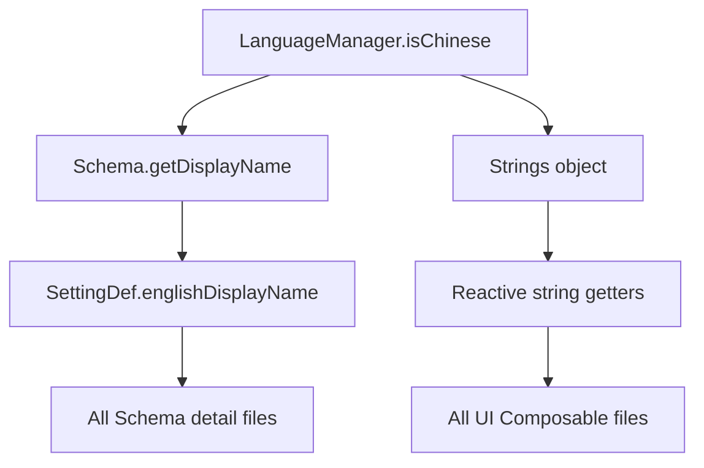

# English Locale Implementation Plan

## Overview

Add English locale support to all UI files under `app/src/main/java/com/coc/zkqcode/jar/ui`. The app already has a [`LanguageManager`](app/src/main/java/com/coc/zkqcode/jar/ui/LanguageManager.kt) with a Compose-reactive `isChinese` flag and a `toggleLanguage()` method. The plan leverages this existing infrastructure.

---

## Architecture

### Two Categories of Strings

1. **Schema `displayName` strings** — Labels defined in [`SettingDef`](app/src/main/java/com/coc/zkqcode/jar/ui/schema/Schema.kt:11) and accessed via [`Schema.getDisplayName()`](app/src/main/java/com/coc/zkqcode/jar/ui/schema/Schema.kt:24). These appear next to switches, inputs, and dropdowns.

2. **Hardcoded UI strings** — Literal Chinese strings scattered across Composable files in `Text()`, `CustomButton()`, dialog titles, status messages, etc.

### Approach



#### 1. Extend `SettingDef` with `englishDisplayName`

```kotlin
data class SettingDef(
    val key: String,
    val displayName: String,
    val englishDisplayName: String = "",  // NEW - defaults to empty
    val defaultValue: Any,
    val category: String
)
```

Update [`Schema.getDisplayName()`](app/src/main/java/com/coc/zkqcode/jar/ui/schema/Schema.kt:24) to check `LanguageManager.isChinese` and fall back to Chinese if English is empty.

#### 2. Create `Strings.kt` — centralized UI string object

A new file at `app/src/main/java/com/coc/zkqcode/jar/ui/Strings.kt` containing an `object Strings` with reactive getters for all non-Schema UI strings. Each property reads `LanguageManager.isChinese` so Compose recomposition triggers automatically.

```kotlin
object Strings {
    // HomeScreen tabs
    val homeTab get() = if (LanguageManager.isChinese) "主页设置" else "Home"
    val accountTab get() = if (LanguageManager.isChinese) "账号设置" else "Accounts"
    // ... hundreds more
}
```

#### 3. Legal Documents — Chinese-only with disclaimer

The legal texts in [`LegalDisclaimers.kt`](app/src/main/java/com/coc/zkqcode/jar/ui/pages/single/LegalDisclaimers.kt) are legally binding Chinese documents. These will remain in Chinese only, with a short English note added: "This document is only available in Chinese."

---

## File-by-File Change Summary

### Schema Core Changes

| File | Change | Status |
|------|--------|--------|
| [`Schema.kt`](app/src/main/java/com/coc/zkqcode/jar/ui/schema/Schema.kt) | Add `englishDisplayName` param to `SettingDef`; update `getDisplayName()` to be language-aware | ✅ |
| [`GlobalSettings.kt`](app/src/main/java/com/coc/zkqcode/jar/ui/schema/details/GlobalSettings.kt) | Add English names for ~60 settings | ✅ |
| [`AccountSettings.kt`](app/src/main/java/com/coc/zkqcode/jar/ui/schema/details/GlobalSettings.kt:132) | Add English names for 8 settings | ✅ |
| [`MainBaseSettings.kt`](app/src/main/java/com/coc/zkqcode/jar/ui/schema/details/MainBaseSettings.kt) | Add English names for ~80 settings | ✅ |
| [`BuilderBaseSettings.kt`](app/src/main/java/com/coc/zkqcode/jar/ui/schema/details/BuilderBaseSettings.kt) | Add English names for ~17 settings | ✅ |
| [`MainBaseBuildings.kt`](app/src/main/java/com/coc/zkqcode/jar/ui/schema/details/MainBaseBuildings.kt) | Add English names for ~55 buildings | ✅ |
| [`MainBaseTroopsAndSpells.kt`](app/src/main/java/com/coc/zkqcode/jar/ui/schema/details/MainBaseTroopsAndSpells.kt) | Add English names for ~45 troops/spells | ✅ |
| [`MainBasePets.kt`](app/src/main/java/com/coc/zkqcode/jar/ui/schema/details/MainBasePets.kt) | Add English names for 12 pets | ✅ |
| [`BuilderBaseBuildings.kt`](app/src/main/java/com/coc/zkqcode/jar/ui/schema/details/BuilderBaseBuildings.kt) | Add English names for buildings | ✅ |
| [`BuilderBaseTroops.kt`](app/src/main/java/com/coc/zkqcode/jar/ui/schema/details/BuilderBaseTroops.kt) | Add English names for troops | ✅ |

### New File

| File | Purpose | Status |
|------|---------|--------|
| `app/src/main/java/com/coc/zkqcode/jar/ui/Strings.kt` | Centralized UI string object with ~200+ reactive string getters | ✅ |

### UI File Changes

Each file below needs hardcoded Chinese strings replaced with `Strings.xxx` references:

| File | Approx Strings | Key String Examples | Status |
|------|---------------|---------------------|--------|
| [`HomeScreen.kt`](app/src/main/java/com/coc/zkqcode/jar/ui/pages/homescreen/HomeScreen.kt) | ~15 | Tab names, section chips, search placeholder, back button, import dialog | ✅ |
| [`HomeScreenBottomBar.kt`](app/src/main/java/com/coc/zkqcode/jar/ui/pages/homescreen/HomeScreenBottomBar.kt) | ~8 | Save/Run/Pause/Exit buttons, exit confirmation dialog | ✅ |
| [`HomeSettings.kt`](app/src/main/java/com/coc/zkqcode/jar/ui/pages/single/HomeSettings.kt) | ~20 | Timer text, quick action cards, tips, dropdown options, explain texts | ✅ |
| [`AnnouncementDialog.kt`](app/src/main/java/com/coc/zkqcode/jar/ui/pages/homescreen/AnnouncementDialog.kt) | ~10 | Loading messages, version check, dialog title | ✅ |
| [`AccountSettings.kt`](app/src/main/java/com/coc/zkqcode/jar/ui/pages/single/AccountSettings.kt) | ~10 | Batch operation labels, dropdown options | ✅ |
| [`AccountConfig.kt`](app/src/main/java/com/coc/zkqcode/jar/ui/pages/single/AccountConfig.kt) | ~5 | Account label, dropdown options, error message | ✅ |
| [`ExtractGameSave.kt`](app/src/main/java/com/coc/zkqcode/jar/ui/pages/single/ExtractGameSave.kt) | ~15 | Dropdown options, buttons, status messages | ✅ |
| [`ConfigFileGrid.kt`](app/src/main/java/com/coc/zkqcode/jar/ui/pages/single/ConfigFileGrid.kt) | ~12 | Labels, buttons, validation messages | ✅ |
| [`Login.kt`](app/src/main/java/com/coc/zkqcode/jar/ui/pages/single/Login.kt) | ~15 | Login messages, buttons, status texts | ✅ |
| [`RandomScheduling.kt`](app/src/main/java/com/coc/zkqcode/jar/ui/pages/single/RandomScheduling.kt) | ~10 | Group titles, labels, buttons | ✅ |
| [`BatchCreateAccount.kt`](app/src/main/java/com/coc/zkqcode/jar/ui/pages/single/BatchCreateAccount.kt) | ~1 | Explain text | ✅ |
| [`BugReport.kt`](app/src/main/java/com/coc/zkqcode/jar/ui/pages/single/BugReport.kt) | ~8 | Title, instructions, buttons, status messages | ✅ |
| [`SwitchAccount.kt`](app/src/main/java/com/coc/zkqcode/jar/ui/pages/single/SwitchAccount.kt) | ~6 | Tip text, labels, buttons, dropdown | ✅ |
| [`MainBaseConfigs.kt`](app/src/main/java/com/coc/zkqcode/jar/ui/pages/mainbase/MainBaseConfigs.kt) | ~15 | Section banners, suffix texts, explain texts, dropdown options, buttons | ✅ |
| [`BuilderBaseConfig.kt`](app/src/main/java/com/coc/zkqcode/jar/ui/pages/builderbase/BuilderBaseConfig.kt) | ~8 | Section banner, explain texts, button | ✅ |
| [`Components.kt`](app/src/main/java/com/coc/zkqcode/jar/ui/components/Components.kt) | ~2 | Dialog title, confirm button | ✅ |
| [`LegalDisclaimers.kt`](app/src/main/java/com/coc/zkqcode/jar/ui/pages/single/LegalDisclaimers.kt) | ~4 | Button labels; legal texts remain Chinese-only | ✅ |

---

## Detailed String Catalog

### HomeScreen Tabs & Sections
| Key | Chinese | English |
|-----|---------|---------|
| `homeTab` | 主页设置 | Home |
| `accountTab` | 账号设置 | Accounts |
| `extractTab` | 提取存档 | Save Data |
| `configTab` | 配置文件 | Profiles |
| `specialTab` | 特殊设置 | Advanced |
| `sectionGeneral` | 通用设置 | General |
| `sectionCoreBattle` | 核心对战 | Core Battle |
| `sectionClan` | 部落设置 | Clan |
| `sectionResearch` | 自动研究 | Research |
| `sectionBuild` | 自动建造 | Build |
| `sectionPet` | 战宠设置 | Pets |
| `sectionNightBase` | 夜世界 | Builder Base |

### HomeScreenBottomBar
| Key | Chinese | English |
|-----|---------|---------|
| `saveAndRun` | 保存并运行 | Save & Run |
| `saveAndPause` | 保存并暂停 | Save & Pause |
| `saveAndExit` | 保存并退出 | Save & Exit |
| `exitTitle` | 退出提示 | Exit Confirmation |
| `exitMessage` | 确认要退出吗？ | Are you sure you want to exit? |
| `cancel` | 取消 | Cancel |
| `confirm` | 确认 | Confirm |
| `cleanAllTitle` | 清除全部数据 | Clear All Data |
| `cleanAllMessage` | 确认要删除所有数据吗？... | Are you sure you want to delete all data?... |

### HomeSettings
| Key | Chinese | English |
|-----|---------|---------|
| `timerRunning` | {seconds}秒后运行 | Running in {seconds}s |
| `timerStopped` | 计时已停止 | Timer stopped |
| `stopTimer` | 停止计时 | Stop Timer |
| `log` | 日志 | Changelog |
| `manualSwitch` | 手动切号？ | Switch Account? |
| `clickSwitch` | 点击切号 | Tap to switch |
| `foundBug` | 发现问题？ | Found a Bug? |
| `clickFeedback` | 点击反馈 | Tap to report |
| `customBg` | 自定义背景 | Custom Background |
| `selectImage` | 选择图片 | Select Image |
| `resetBg` | 重置背景 | Reset Background |
| `restoreDefault` | 恢复默认 | Restore Default |
| `bgResetSuccess` | 背景已重置 | Background reset |
| `bgResetFail` | 重置失败 | Reset failed |
| `tipChangeDevice` | 换机前务必清除数据 保护账号安全 | Clear data before switching devices to protect your account |
| `clearMemory` | 清除账号记忆 | Clear Account Cache |
| `clearAllData` | 清除全部数据 | Clear All Data |
| `importOldData` | 导入旧版数据 | Import Legacy Data |
| `syncTime` | 同步时间 | Sync Time |
| `autoUpdateOff` | 关闭自动更新 | Auto-update Off |
| `autoUpdateOnLaunch` | 仅启动时更新 | Update on Launch |
| `autoUpdateRealtime` | 实时自动更新 | Real-time Update |
| `afterKickReconnect` | 立刻重连 | Reconnect Immediately |
| `afterKickSwitch` | 切换账号 | Switch Account |
| `afterKickWait` | 原地等待 | Wait in Place |

### AnnouncementDialog
| Key | Chinese | English |
|-----|---------|---------|
| `changelogTitle` | 更新日志 | Changelog |
| `fetchingUpdates` | 正在获取更新记录... | Fetching updates... |
| `fetchFailed` | 获取更新记录失败: {error} | Failed to fetch updates: {error} |
| `checkingVersion` | 正在检查版本信息... | Checking version... |
| `checkFailed` | 检查版本失败: {error} | Version check failed: {error} |
| `newVersion` | 检测到新版本! | New version detected! |
| `currentLatest` | 当前已是最新版本 | Already up to date |
| `versionInfoUnavailable` | 无法获取版本信息 | Version info unavailable |
| `updateLogHeader` | 更新记录: | Update Log: |
| `moreLogsFooter` | 更多更新记录可前往官网教程文档内查看 | For more update logs, visit the official website |
| `gotIt` | 明白了 | Got it |

### AccountSettings
| Key | Chinese | English |
|-----|---------|---------|
| `selectAll` | 一键全选 | Select All |
| `invertSelection` | 一键反选 | Invert Selection |
| `applyConfigLabel` | 将配置 | Apply profile |
| `toAccounts` | 应用到账号 | to accounts |
| `changeTo` | 改为 | to |
| `cnServer` | 国服 | CN Server |
| `globalServer` | 国际服 | Global Server |
| `atrasis` | Atrasis | Atrasis |

### AccountConfig
| Key | Chinese | English |
|-----|---------|---------|
| `account` | 账号{index} | Account {index} |
| `randomSchedulingNote` | 已开启随机上号，请在右上角前往特殊设置页面->随机上号... | Random scheduling enabled. Go to Advanced > Random Scheduling... |
| `globalNotSupported` | 国际服不支持测试功能，请更换启动游戏方式！ | Test mode not supported for Global server! |
| `gameSave` | 游戏存档 | Game Save |
| `directLaunch` | 直接启动 | Direct Launch |
| `testMode` | 测试功能 | Test Mode |

### ExtractGameSave
| Key | Chinese | English |
|-----|---------|---------|
| `extractFailedExists` | 提取失败，存档已存在 | Extract failed - save already exists |
| `extracting` | 提取中... | Extracting... |
| `extractSuccess` | 提取成功！ | Extract successful! |
| `deleteFailedNotExist` | 删除失败，存档不存在 | Delete failed - save not found |
| `deleting` | 删除中... | Deleting... |
| `deleteSuccess` | 删除成功！ | Delete successful! |
| `deleteFailedPermission` | 删除失败，请检查权限 | Delete failed - check permissions |
| `errorNoSlot` | 错误：未获取到路径序号 | Error: slot number not found |
| `errorSlotEmpty` | 错误：序号不能为空 | Error: slot cannot be empty |
| `errorContentEmpty` | 错误：数据内容不能为空 | Error: content cannot be empty |
| `saveSuccess` | 保存成功！ | Save successful! |
| `saveFailedPermission` | 保存失败，请检查权限 | Save failed - check permissions |
| `deleteDataFailedNotExist` | 删除失败，该序号数据不存在 | Delete failed - slot data not found |
| `extractRegionData` | 提取{region}数据 | Extract {region} Data |
| `deleteExistingData` | 删除现有数据 | Delete Existing Data |
| `saveData` | 保存数据 | Save Data |
| `deleteData` | 删除数据 | Delete Data |

### ConfigFileGrid
| Key | Chinese | English |
|-----|---------|---------|
| `syncProfileLabel` | 将配置文件 | Sync profile |
| `syncToProfile` | 同步至配置文件 | to profiles |
| `invalidProfileNumber` | 请输入有效的配置文件序号 | Please enter valid profile numbers |
| `sourceOutOfRange` | 源配置文件序号必须在 1-{count} 之间 | Source profile must be between 1-{count} |
| `targetOutOfRange` | 目标配置文件序号必须在 1-{count} 之间 | Target profiles must be between 1-{count} |
| `startGreaterThanEnd` | 目标配置文件起始序号不能大于结束序号 | Start cannot be greater than end |
| `noTargetsToSync` | 目标范围内没有可同步的配置文件 | No profiles to sync in range |
| `syncSuccess` | 配置文件{from} 已同步至 配置文件{targets} | Profile {from} synced to {targets} |
| `skippedSelf` | 已跳过配置文件{n} | Skipped profile {n} |
| `profileHint` | 点击方格调整配置文件。调整完成后，回到"账号设置"，给每个账号分配所需的配置文件。 | Tap a cell to edit. Then go to Accounts to assign profiles. |
| `profileFile` | 配置文件{i} | Profile {i} |
| `remark` | 备注: {text} | Note: {text} |

### Login
| Key | Chinese | English |
|-----|---------|---------|
| `adFreeMessage` | 登录后免广告，运行更高效！... | Login for ad-free experience!... |
| `sponsorMessage` | 免费辅助制作不易... | Your sponsorship keeps this project going! |
| `welcomeBack` | 欢迎回来，感谢赞助！紫孔雀因你而变得更好！ | Welcome back! Thank you for sponsoring! |
| `currentGems` | 当前宝石数量：{value} | Current Gems: {value} |
| `invalidEmail` | 请输入正确的邮箱！ | Please enter a valid email! |
| `loggingIn` | 登录中，请稍后... | Logging in... |
| `powFailed` | 验证获取失败: {error} | Verification failed: {error} |
| `prepFailed` | 准备信息失败: {error} | Preparation failed: {error} |
| `transmitFailed` | 传输信息失败，请重试 | Transmission failed, please retry |
| `loginFailed` | 登录失败: {error} | Login failed: {error} |
| `loginSuccess` | 登录成功！卡班积分数量 {value} | Login successful! Caban Points: {value} |
| `loginSuccessParseFail` | 登录成功，但无法解析数据: {data} | Login successful but failed to parse data |
| `emailPasswordError` | 邮箱或密码错误，请检查后重试 | Incorrect email or password |
| `login` | 登录 | Login |
| `donate` | 捐赠 | Donate |
| `logout` | 退出 | Logout |
| `logoutSuccess` | 退出成功 | Logged out |
| `donateInfo` | 前往官网即可注册捐赠... | Visit the website to register... |

### RandomScheduling
| Key | Chinese | English |
|-----|---------|---------|
| `dawnGroup` | 凌晨组 0:00 - 6:00 | Dawn 0:00 - 6:00 |
| `morningGroup` | 上午组 6:00 - 12:00 | Morning 6:00 - 12:00 |
| `afternoonGroup` | 下午组 12:00 - 18:00 | Afternoon 12:00 - 18:00 |
| `nightGroup` | 夜晚组 18:00 - 24:00 | Night 18:00 - 24:00 |
| `remainingProbBattle` | 剩余概率随机持续对战 | Remaining probability for continuous battle |
| `to` | 至 | to |
| `minutesThenOffline` | 分钟后下线 | min then go offline |
| `selectAccountsForGroup` | 选择加入本组的账号： | Select accounts for this group: |
| `tapOrDragHint` | 点击或长按拖拽均可调节账号开启状态。 | Tap or long-press drag to toggle accounts. |

### BugReport
| Key | Chinese | English |
|-----|---------|---------|
| `bugReportTitle` | 问题反馈 | Bug Report |
| `bugReportInstructions` | 提交截图前，请先与作者/客服联系... | Before submitting, contact the author... |
| `submitScreenshot` | 提交截图 | Submit Screenshot |
| `submitting` | 正在提交... | Submitting... |
| `screenshotFailed` | 截图保存失败，截图为空。 | Screenshot failed - empty capture. |
| `submitSuccess` | 截图提交成功！请与作者/客服联系。 | Screenshot submitted! Please contact the author. |
| `submitFailed` | 提交失败：{error} | Submit failed: {error} |
| `closeWindow` | 关闭窗口 | Close Window |
| `capturing` | 截屏中，请耐心等待 | Capturing screenshot, please wait |

### SwitchAccount
| Key | Chinese | English |
|-----|---------|---------|
| `switchTip` | 小提示：在悬浮窗点击此按钮，即可回到切号工具。 | Tip: Tap this button in the floating window to return. |
| `switchToNth` | 切换到第 | Switch to |
| `nthAccount` | 个账号 | th account |
| `confirmSwitch` | 确认切号 | Confirm Switch |

### MainBaseConfigs
| Key | Chinese | English |
|-----|---------|---------|
| `generalSettings` | 通用设置 | General |
| `battleSettingsMain` | 对战设置（主世界） | Battle Settings - Main Base |
| `clanSettings` | 部落设置 | Clan Settings |
| `researchSettings` | 研究设置 | Research Settings |
| `buildSettingsMain` | 建造设置（主世界） | Build Settings - Main Base |
| `petAndOther` | 战宠&其他设置 | Pets & Other |
| `adjustMainBasePriority` | 点击调整主世界建筑升级 | Adjust Main Base Upgrade Priority |
| `secondsSuffix` | 秒钟 | seconds |
| `percentStartBattle` | ％时开始对战 | % start battle |
| `percentStop` | ％为止 | % stop |
| `levelAccountsSuffix` | 级的账号 | level accounts |
| `directStart` | 直接开启 | Direct Start |
| `recentOnline` | 最近上线 | Recent Online |

### BuilderBaseConfig
| Key | Chinese | English |
|-----|---------|---------|
| `builderBaseSettings` | 夜世界专属设置 | Builder Base Settings |
| `adjustBuilderBasePriority` | 点击调整夜世界建筑升级 | Adjust Builder Base Upgrade Priority |

### Components
| Key | Chinese | English |
|-----|---------|---------|
| `noticeTitle` | 注意事项 | Notice |
| `gotIt` | 明白了 | Got it |

### HomeScreen - Import Dialog
| Key | Chinese | English |
|-----|---------|---------|
| `importOldTitle` | 导入旧版数据 | Import Legacy Data |
| `importOldMessage` | 导入旧版数据将覆盖当前配置... | Importing will overwrite current configs... |
| `scanningImport` | 正在扫描导入并覆盖配置... | Scanning and importing configs... |
| `importSuccess` | 旧版本数据导入成功且已保存 | Legacy data imported and saved |
| `noOldData` | 未找到任何旧版数据 | No legacy data found |
| `initializing` | 正在初始化配置... | Initializing configs... |
| `back` | ◀ 返回 | ◀ Back |
| `searchSettings` | 搜索设置... | Search settings... |

### HomeSettings - Explain Texts
| Key | Chinese | English |
|-----|---------|---------|
| `disableRestartExplain` | 勾选后，所有重启游戏的设定将失效... | Disabling restart may cause stuck screens... |
| `batchCreateExplain` | 启用批量创号后... | After enabling batch creation... |
| `randomSchedulingExplain` | 启用随机上号后... | After enabling random scheduling... |

### MainBaseConfigs - Explain Texts
| Key | Chinese | English |
|-----|---------|---------|
| `smartDecisionExplain` | 开启后，辅助会自动检测大本营等级... | Auto-detect TH level and skip content... |
| `tournamentExplain` | 排位赛不保证胜率，请谨慎开启。 | No win rate guarantee for ranked battles. |
| `dynamicAdjustExplain` | 启用后，辅助将自动跳过前两个搜索目标... | Skip first 2 searches and adjust dynamically... |
| `waitForBattleExplain` | 启用后，若当前处于对战冷却期... | Wait during battle cooldown... |
| `waitForBattleAfterTaskExplain` | 启用后，若已接取主世界竞赛任务... | Wait after accepting clan games task... |
| `restartGameExplain` | 启用后，辅助将在部署全部部队后自动重启游戏。 | Restart game after deploying troops. |
| `manualTrainingExplain` | 启用后，辅助将跳过配兵流程... | Skip troop training - configure manually. |
| `claimRewardsExplain` | 优先领取魔法书和宝石，其他随机领取。 | Prioritize books and gems, others random. |
| `clanWarExplain` | 部落战其中一次打对位... | One attack on mirror, one on recommended... |
| `leagueExplain` | 默认打对位... | Default attack on mirror... |
| `startClanWarExplain` | 直接开启：凑够5的倍数就立刻开启... | Direct: start when divisible by 5... |
| `autoJoinClanExplain` | 启用后，辅助将自动申请加入部落... | Auto-join clan when enabled... |
| `buildSettingExplain` | 建造时会忽略可改装的建筑... | Ignores gear-up buildings during construction... |
| `gearUpExplain` | 改装建筑属于主世界功能... | Gear-up is a main base feature... |
| `saveWorkerBuildExplain` | 本功能依赖智能决策... | Requires Smart Decision... |
| `batchWallExplain` | 此功能对已开启月卡的账号不生效。 | Does not apply to Gold Pass accounts. |
| `upgradeAllGearExplain` | 启用后，辅助将同时自动升级已穿戴的装备。 | Auto-upgrade equipped gear. |
| `helperExplain` | 启用后，辅助将自动使用实验助手及建筑工人学徒。 | Auto-use Research Helper and Builder Apprentice. |
| `researchHelperExplain` | 实验助手的升级优先级低于购买新建筑工人... | Research Helper upgrade priority is below new builders... |
| `builderApprenticeExplain` | 工人学徒的升级优先级低于购买新建筑工人及升级实验助手. | Builder Apprentice upgrade priority is below Research Helper... |
| `removeObstaclesExplain` | 启用后，当主世界金币或圣水超过30万时生效... | Active when gold/elixir exceeds 300k... |
| `continuousRemoveExplain` | 启用后，辅助将不再记录移除时间... | Remove obstacles every run without tracking time... |
| `removeObstaclesEnhanceExplain` | 启用后，移除障碍物时将增加随机点击操作... | Add random clicks to increase rare obstacle chance... |

### BuilderBaseConfig - Explain Texts
| Key | Chinese | English |
|-----|---------|---------|
| `noBuilderBaseExplain` | 启用后，辅助将不再进入夜世界... | Disables Builder Base entirely... |
| `builderBaseFarmingExplain` | 辅助将自动完成兵种配置... | Auto-configure troops... |
| `trophyPushingExplain` | 启用后，辅助将使用暗夜女巫进行上分... | Uses Night Witch for trophy pushing... |
| `elixirCartExplain` | 启用后，夜世界对战中部署兵种后将立即投降... | Deploy then surrender for elixir carts... |
| `builderBaseRemoveObstaclesExplain` | 若尚未解锁第二区域... | If 2nd area not unlocked... |
| `builderBaseContinuousRemoveExplain` | 启用后，辅助将不再记录移除时间... | Remove obstacles every run... |
| `builderBaseSaveWorkerBuildExplain` | 本功能依赖智能决策... | Requires Smart Decision... |

---

## Implementation Order

- [x] 1. **Schema core** — Extend `SettingDef`, update `Schema.getDisplayName()`
- [x] 2. **Strings.kt** — Create centralized string object
- [x] 3. **Schema detail files** — Add `englishDisplayName` to all settings
- [x] 4. **UI files** — Replace hardcoded strings one file at a time
- [x] 5. **Build & test** — Verify compilation and runtime behavior

## Notes

- All string getters in `Strings` use `get()` so they read `LanguageManager.isChinese` at composition time, ensuring automatic recomposition on language toggle.
- The `SettingDef.englishDisplayName` defaults to `""` so existing code is not broken if a translation is missing — it falls back to Chinese.
- Legal documents in `LegalDisclaimers.kt` remain Chinese-only since they are legally binding.
- Debug messages and `ShowMessage` calls can use bilingual format as per AGENTS.md rules.
- Dropdown option lists that are currently `listOf("国服", "国际服", ...)` must be converted to use `Strings` getters.
