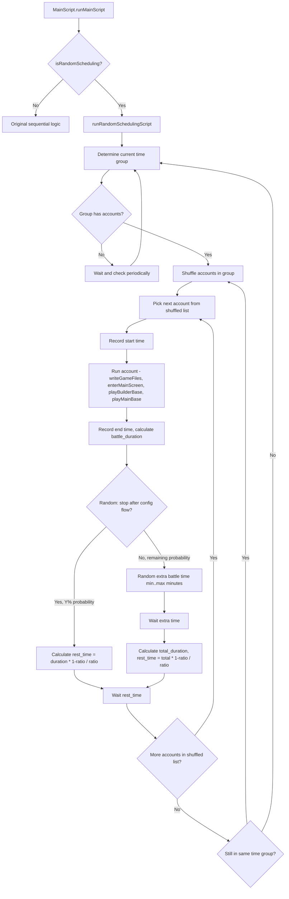
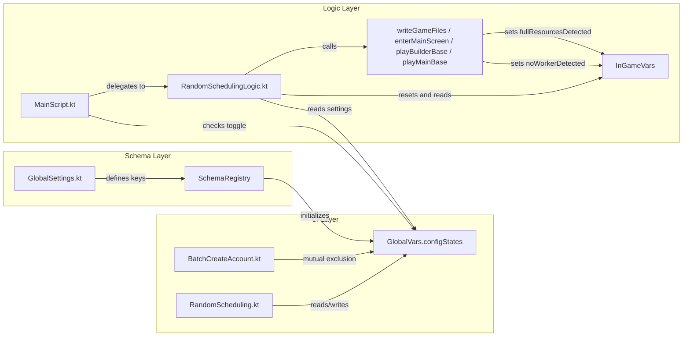
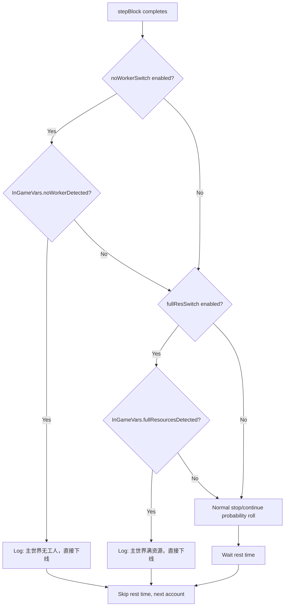

# Random Account Scheduling (随机上号) — Architecture Plan

## 1. Feature Overview

Add a **random account scheduling** system that divides the day into 4 time groups and runs assigned accounts in random order with configurable battle/rest ratios. This replaces the default sequential account switching when enabled.

### Time Groups
| Group | Chinese Name | Time Range |
|-------|-------------|------------|
| Dawn  | 凌晨组 | 0:00 – 6:00 |
| Morning | 上午组 | 6:00 – 12:00 |
| Afternoon | 下午组 | 12:00 – 18:00 |
| Night | 夜晚组 | 18:00 – 24:00 |

### Per-Group Settings
- **Battle time ratio** (对战时间比例): `X%` — rest time formula: `actual_battle_time × (100% - X%) / X%`
- **Probability to stop after config flow** (完成配置文件流程后下线概率): `Y%`
- **Random continue battle min/max** (随机持续对战时间范围): `min` – `max` minutes
- **No worker switch** (主世界无工人后下线): toggle — detect `WorkerInfo.available == 0` at start of `playMainBase`
- **Full resources switch** (主世界满资源后下线): toggle — detect all-resources-full inside `searchOpponentsAndDeployTroops`

### Account Assignment
- Each account can be assigned to **one or more** groups
- Available accounts are synced with the account count from 账号设置
- UI shows toggle buttons per account per group

---

## 2. Architecture Diagram



---

## 3. File Changes

### 3.1 New Schema Settings — [`GlobalSettings.kt`](app/src/main/java/com/coc/zkqcode/jar/ui/schema/details/GlobalSettings.kt)

Add the following `SettingDef` entries:

```kotlin
// Master toggle
val RANDOM_SCHEDULING = SettingDef("random_scheduling", "随机上号", 0, "GLOBAL_SETTINGS")

// Per-group settings (4 groups: dawn, morning, afternoon, night)
// NOTE: displayName is GENERIC (shared label) — the group title (e.g. "凌晨组") is shown
// as a section header in the UI, NOT embedded in the displayName.
// Keys use meaningful English group names as suffix to avoid Schema.getDisplayName()
// stripping trailing digits and failing to find the base key.

// Battle time ratio
val RS_BATTLE_RATIO_DAWN = SettingDef("rs_battle_ratio_dawn", "对战时间比例", "80", "GLOBAL_SETTINGS")
val RS_BATTLE_RATIO_MORNING = SettingDef("rs_battle_ratio_morning", "对战时间比例", "80", "GLOBAL_SETTINGS")
val RS_BATTLE_RATIO_AFTERNOON = SettingDef("rs_battle_ratio_afternoon", "对战时间比例", "80", "GLOBAL_SETTINGS")
val RS_BATTLE_RATIO_NIGHT = SettingDef("rs_battle_ratio_night", "对战时间比例", "80", "GLOBAL_SETTINGS")

// Probability to stop after config flow
val RS_STOP_PROB_DAWN = SettingDef("rs_stop_prob_dawn", "完成流程下线概率", "50", "GLOBAL_SETTINGS")
val RS_STOP_PROB_MORNING = SettingDef("rs_stop_prob_morning", "完成流程下线概率", "50", "GLOBAL_SETTINGS")
val RS_STOP_PROB_AFTERNOON = SettingDef("rs_stop_prob_afternoon", "完成流程下线概率", "50", "GLOBAL_SETTINGS")
val RS_STOP_PROB_NIGHT = SettingDef("rs_stop_prob_night", "完成流程下线概率", "50", "GLOBAL_SETTINGS")

// Random continue min (minutes)
val RS_CONTINUE_MIN_DAWN = SettingDef("rs_continue_min_dawn", "随机持续对战最短", "5", "GLOBAL_SETTINGS")
val RS_CONTINUE_MIN_MORNING = SettingDef("rs_continue_min_morning", "随机持续对战最短", "5", "GLOBAL_SETTINGS")
val RS_CONTINUE_MIN_AFTERNOON = SettingDef("rs_continue_min_afternoon", "随机持续对战最短", "5", "GLOBAL_SETTINGS")
val RS_CONTINUE_MIN_NIGHT = SettingDef("rs_continue_min_night", "随机持续对战最短", "5", "GLOBAL_SETTINGS")

// Random continue max (minutes)
val RS_CONTINUE_MAX_DAWN = SettingDef("rs_continue_max_dawn", "随机持续对战最长", "25", "GLOBAL_SETTINGS")
val RS_CONTINUE_MAX_MORNING = SettingDef("rs_continue_max_morning", "随机持续对战最长", "25", "GLOBAL_SETTINGS")
val RS_CONTINUE_MAX_AFTERNOON = SettingDef("rs_continue_max_afternoon", "随机持续对战最长", "25", "GLOBAL_SETTINGS")
val RS_CONTINUE_MAX_NIGHT = SettingDef("rs_continue_max_night", "随机持续对战最长", "25", "GLOBAL_SETTINGS")

// No worker toggle
val RS_NO_WORKER_DAWN = SettingDef("rs_no_worker_dawn", "主世界无工人后下线", 0, "GLOBAL_SETTINGS")
val RS_NO_WORKER_MORNING = SettingDef("rs_no_worker_morning", "主世界无工人后下线", 0, "GLOBAL_SETTINGS")
val RS_NO_WORKER_AFTERNOON = SettingDef("rs_no_worker_afternoon", "主世界无工人后下线", 0, "GLOBAL_SETTINGS")
val RS_NO_WORKER_NIGHT = SettingDef("rs_no_worker_night", "主世界无工人后下线", 0, "GLOBAL_SETTINGS")

// Full resources toggle
val RS_FULL_RES_DAWN = SettingDef("rs_full_res_dawn", "主世界满资源后下线", 0, "GLOBAL_SETTINGS")
val RS_FULL_RES_MORNING = SettingDef("rs_full_res_morning", "主世界满资源后下线", 0, "GLOBAL_SETTINGS")
val RS_FULL_RES_AFTERNOON = SettingDef("rs_full_res_afternoon", "主世界满资源后下线", 0, "GLOBAL_SETTINGS")
val RS_FULL_RES_NIGHT = SettingDef("rs_full_res_night", "主世界满资源后下线", 0, "GLOBAL_SETTINGS")

// Account group assignments (comma-separated account IDs)
val RS_ACCOUNTS_DAWN = SettingDef("rs_accounts_dawn", "账号列表", "", "GLOBAL_SETTINGS")
val RS_ACCOUNTS_MORNING = SettingDef("rs_accounts_morning", "账号列表", "", "GLOBAL_SETTINGS")
val RS_ACCOUNTS_AFTERNOON = SettingDef("rs_accounts_afternoon", "账号列表", "", "GLOBAL_SETTINGS")
val RS_ACCOUNTS_NIGHT = SettingDef("rs_accounts_night", "账号列表", "", "GLOBAL_SETTINGS")
```

All these must also be added to the `all` list.

### 3.2 New UI File — [`RandomScheduling.kt`](app/src/main/java/com/coc/zkqcode/jar/ui/pages/single/RandomScheduling.kt)

New composable file at `jar/ui/pages/single/RandomScheduling.kt`.

**Structure:**
```
@Composable fun RandomScheduling()
  ├── SettingSwitchIcon(RANDOM_SCHEDULING) with mutual exclusion against BATCH_CREATE_ACCOUNT
  ├── AnimatedVisibility(when enabled)
  │   ├── TimeGroupSection(groupIndex=0, "凌晨组 0:00-6:00")
  │   ├── TimeGroupSection(groupIndex=1, "上午组 6:00-12:00")
  │   ├── TimeGroupSection(groupIndex=2, "下午组 12:00-18:00")
  │   └── TimeGroupSection(groupIndex=3, "夜晚组 18:00-24:00")

@Composable fun TimeGroupSection(groupIndex: Int, title: String)
  ├── SectionBanner(title, expandable)
  ├── AnimatedVisibility
  │   ├── SettingInputRow(RS_BATTLE_RATIO_{groupIndex}, suffix="%")
  │   ├── Row: Text("") + SettingInputRow(RS_STOP_PROB_{groupIndex}, suffix="%") + Text("概率完成配置文件流程后下线")
  │   ├── Row: Text("剩余概率随机持续对战") + SettingInputRow(RS_CONTINUE_MIN_{groupIndex}) + Text("-") + SettingInputRow(RS_CONTINUE_MAX_{groupIndex}) + Text("分钟后下线")
  │   ├── SettingSwitchIcon(RS_NO_WORKER_{groupIndex})
  │   ├── SettingSwitchIcon(RS_FULL_RES_{groupIndex})
  │   └── AccountSelector(groupIndex) — FlowRow of SettingToggleButton-style buttons for each account
```

**Account Selector** stores selected account IDs as a comma-separated string in `RS_ACCOUNTS_{groupIndex}`. When account count changes, the UI dynamically adjusts available account buttons.

### 3.3 Modify [`HomeScreen.kt`](app/src/main/java/com/coc/zkqcode/jar/ui/pages/single/HomeScreen.kt)

In the `4 ->` (特殊设置) tab section, add `RandomScheduling()` below `BatchCreateAccount()`:

```kotlin
4 -> {
    item {
        SettingSection {
            BatchCreateAccount()
        }
    }
    item {
        SettingSection {
            RandomScheduling()
        }
    }
}
```

### 3.4 Mutual Exclusion Logic

In [`BatchCreateAccount.kt`](app/src/main/java/com/coc/zkqcode/jar/ui/pages/single/BatchCreateAccount.kt):
- When `BATCH_CREATE_ACCOUNT` is toggled ON → set `RANDOM_SCHEDULING` to "0"

In `RandomScheduling.kt`:
- When `RANDOM_SCHEDULING` is toggled ON → set `BATCH_CREATE_ACCOUNT` to "0"

### 3.5 Modify [`InGamesVars.kt`](app/src/main/java/com/coc/zkqcode/jar/code/universal/InGamesVars.kt)

Add two `@Volatile` flags to `InGameVars`:

```kotlin
object InGameVars {
    @Volatile var currentAccountNumber: Int = 1
    @Volatile var currentGameVersion: GameVersion = GameVersion.CN
    var adTime: Int = 15

    // Set by playMainBase; read by RandomSchedulingLogic after stepBlock
    @Volatile var noWorkerDetected: Boolean = false
    @Volatile var fullResourcesDetected: Boolean = false
}
```

Reset both flags to `false` in `RandomSchedulingLogic` **before** each account's `stepBlock` runs, so stale values from a previous account never bleed through.

---

### 3.6 Modify [`MainBaseScript.kt`](app/src/main/java/com/coc/zkqcode/jar/code/mainbase/MainBaseScript.kt)

After `enterMainBase()` succeeds, detect workers and set the flag:

```kotlin
suspend fun playMainBase(): Boolean {
    if (!enterMainBase()) return false

    // Detect no-worker condition for random scheduling
    val workerInfo = WorkerAndResearch.detectWorkerNumber(BaseType.Main)
    if (workerInfo.available == 0) {
        InGameVars.noWorkerDetected = true
        accountMessage("主世界无空闲工人")
    }

    // ... rest of the flow unchanged
}
```

---

### 3.7 Modify [`SearchOpponents.kt`](app/src/main/java/com/coc/zkqcode/jar/code/mainbase/attack/SearchOpponents.kt)

The color-bar full-resource check already runs at lines 72–93. After the existing `fullResources` list is built, set the flag when all three are full:

```kotlin
// After the existing fullResources detection block:
if (targetGold == 0 && targetElixir == 0 && targetDarkElixir == 0) {
    InGameVars.fullResourcesDetected = true
}
```

This is placed **before** the `STOP_BATTLE_AFTER_FULL_RESOURCES` early-return check, so the flag is always set regardless of that per-account setting.

---

### 3.8 New Logic File — [`RandomSchedulingLogic.kt`](app/src/main/java/com/coc/zkqcode/jar/code/universal/RandomSchedulingLogic.kt)

Core scheduling algorithm in `jar/code/universal/RandomSchedulingLogic.kt`.

**Key functions:**

```kotlin
// Determine which time group index (0-3) based on current hour
fun getCurrentTimeGroup(): Int

// Get account list for a group from config
fun getGroupAccounts(groupIndex: Int): List<Int>

// Get group settings (ratio, probability, min, max, noWorker, fullRes)
data class GroupSettings(
    val battleRatio: Int,
    val stopProbability: Int,
    val continueMin: Int,
    val continueMax: Int,
    val noWorkerSwitch: Boolean,
    val fullResSwitch: Boolean
)
fun getGroupSettings(groupIndex: Int): GroupSettings

// Calculate rest time: battle_duration_ms * (100 - ratio) / ratio
fun calculateRestTime(battleDurationMs: Long, ratioPercent: Int): Long

// Main entry point
suspend fun runRandomSchedulingScript()
```

**`runRandomSchedulingScript()` algorithm:**
1. Determine current time group via `getCurrentTimeGroup()`
2. Get accounts for that group
3. If no accounts → wait 60s, re-check (time group might change)
4. Shuffle accounts randomly
5. For each account in shuffled list:
   a. **Reset** `InGameVars.noWorkerDetected = false` and `InGameVars.fullResourcesDetected = false`
   b. Set `InGameVars.currentAccountNumber` and `currentGameVersion`
   c. Record `startTime`
   d. Execute the standard account flow: `writeGameFiles()` → `enterMainScreen()` → `playBuilderBase()` → `playMainBase()`
   e. Record `endTime`, calculate `battleDuration = endTime - startTime`
   f. **Check early-offline conditions** (evaluated after `stepBlock` returns):
      - If `noWorkerSwitch && InGameVars.noWorkerDetected` → skip rest time, go offline immediately (log reason), continue to next account
      - If `fullResSwitch && InGameVars.fullResourcesDetected` → skip rest time, go offline immediately (log reason), continue to next account
   g. Random roll against `stopProbability`:
      - **Stop (Y%)**: Calculate `restTime = battleDuration × (100 - ratio) / ratio`, wait `restTime`
      - **Continue ((100-Y)%)**: Random extra time in `[continueMin, continueMax]` minutes, wait that time. Then calculate `totalDuration = battleDuration + extraTime`, `restTime = totalDuration × (100 - ratio) / ratio`, wait `restTime`
   h. Before picking next account, check if still in same time group. If not, break and re-evaluate.
6. After all accounts done, if still in same time group → re-shuffle and repeat
7. If time group changed → go to step 1

### 3.9 Modify [`MainScript.kt`](app/src/main/java/com/coc/zkqcode/jar/code/MainScript.kt)

Add a branch at the top of `runMainScript()` after auth and batch-create check:

```kotlin
val isRandomScheduling = getConfigOrStop(Schema.GLOBAL_SETTINGS.RANDOM_SCHEDULING.key) == "1"

if (isRandomScheduling) {
    runRandomSchedulingScript()
    return
}
// ... existing sequential logic continues
```

This should go **after** `userAuth()` and the hot-update check, but **before** the account counting logic.

---

## 4. Data Flow



---

## 5. Early-Offline Decision Flow



---

## 6. Edge Cases

| Scenario | Behavior |
|----------|----------|
| No accounts in current time group | Wait 60s, re-check time group |
| All time groups empty | Loop waiting indefinitely with periodic messages |
| Account count changed at runtime | Not handled — config is assumed static during runtime |
| Time group transitions mid-account | Finish current account, then evaluate new group |
| Battle ratio = 0% | Rest time would be infinite — clamp to minimum ratio of 1% |
| Battle ratio = 100% | Rest time = 0, proceed immediately |
| continueMin > continueMax | Swap values or use min as the value |
| Random scheduling + batch create both enabled | Mutual exclusion prevents this via UI |
| noWorkerDetected but noWorkerSwitch disabled | Flag is set but ignored; normal rest-time logic applies |
| fullResourcesDetected but fullResSwitch disabled | Flag is set but ignored; normal rest-time logic applies |
| Both noWorker and fullRes triggered simultaneously | noWorker check runs first; either condition causes immediate offline |
| Worker detection fails (returns WorkerInfo 0,0) | available == 0 triggers the flag — acceptable false positive; detection failure is rare |

---

## 7. Files Summary

| File | Action | Description |
|------|--------|-------------|
| `jar/ui/schema/details/GlobalSettings.kt` | **Modify** | Add ~25 new SettingDef entries + update `all` list |
| `jar/ui/pages/single/RandomScheduling.kt` | **Create** | New UI composable for random scheduling settings |
| `jar/ui/pages/single/HomeScreen.kt` | **Modify** | Add RandomScheduling to 特殊设置 tab |
| `jar/ui/pages/single/BatchCreateAccount.kt` | **Modify** | Add mutual exclusion with random scheduling |
| `jar/code/universal/InGamesVars.kt` | **Modify** | Add `noWorkerDetected` and `fullResourcesDetected` flags |
| `jar/code/mainbase/MainBaseScript.kt` | **Modify** | Detect worker count after `enterMainBase()`, set flag |
| `jar/code/mainbase/attack/SearchOpponents.kt` | **Modify** | Set `fullResourcesDetected` when all resources are full |
| `jar/code/universal/RandomSchedulingLogic.kt` | **Modify** | Reset flags before stepBlock; check flags after stepBlock for early offline |
| `jar/code/MainScript.kt` | **Modify** | Branch to random scheduling when enabled |
